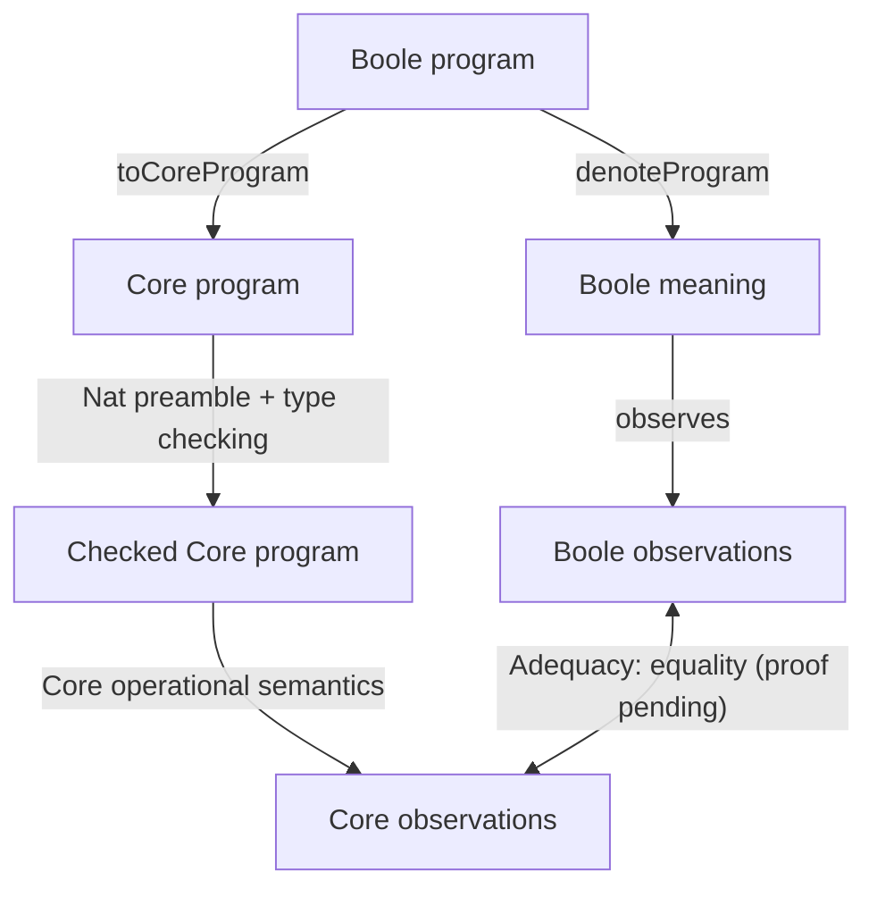

# Boole Semantics

## Motivation

In the existing StrataBoole pipeline, a Boole program gets its meaning through `toCoreProgram`: translate it into Strata Core, then use Core's semantics. This gives Boole an **induced meaning**, but no independent account of what its own
constructs mean. A global variable, for example, is understood through the extra
procedure parameters introduced by the lowering.

Boole is intended to serve as a translation target as well as a language people
write directly. A future Verus-to-Boole translation should be able to state what
it preserves in terms of Boole variables, procedures, and specifications. Keeping
Boole solely as syntactic sugar would make that contract depend on downstream
encoding choices. An independent semantics gives front ends a stable target and
gives the lowering a precise correctness obligation.

This folder introduces that semantics. The design requirement is that it
**provably matches the existing Core meaning**. The adequacy theorem is stated;
its proof remains to be completed. The proof status below describes the
unsupported-global regression and the remaining work. The definitions now give native carriers to Boole’s type forms and interpret
a structured program fragment. The current concrete Core comparison covers a
smaller, explicitly checked source fragment; defining a type’s carrier does not
prove its agreement with Core.

Two standard ways to define a language's behavior are operational semantics,
which describe execution through rules, and denotational semantics, which assign
mathematical meanings to programs. We choose the latter: functions and relations
formalized in Lean, using native Lean values, including integers, bitvectors, lists, and functions. This document
provides an English introduction and a short reference for the implemented
fragment alongside those formal definitions. [Cornell's introduction](https://www.cs.cornell.edu/courses/cs6110/2022sp/lectures/lec22.pdf)
explains the distinction between the semantic approaches.

A denotational presentation fits the immediate goals: define meanings
compositionally, reason about them mathematically, and relate them to the
existing implementation. A separate operational presentation could be added
later and proved equivalent for the same observations. That would provide
another account of the language's behavior without requiring a change to its
intended meaning.

## Construction of the semantics

### From syntax to meaning

A *denotation* is the mathematical meaning assigned to a piece of syntax.
Expressions receive meanings that read a state and produce values. Statements
receive meanings that relate initial states to permitted outcomes.

The definitions are **compositional**: the meaning of a construct is assembled
from the meanings of its parts. Addition combines two expression meanings;
sequencing combines two statement meanings. This is the familiar approach used
in the [denotational semantics of imperative programs](https://www.cs.cornell.edu/courses/cs4110/2020fa/lectures/lecture07.pdf).

The implementation separates the structural construction from the particular
mathematical operations it uses:

```text
Boole program AST + source name context
                  |
                  | denoteProgram = interpProgram denotation
                  v
             ProgramMeaning
                  |
                  +-- global variable declarations
                  +-- procedures
                        +-- input/output declarations
                        +-- contract expression meanings
                        +-- body meaning
```

The files separate the shared construction from its semantic instances:


| File                             | Responsibility                                                                                                                     |
| -------------------------------- | ---------------------------------------------------------------------------------------------------------------------------------- |
| [Types.lean](../Types.lean)         | Source type codes, their Lean carriers, and explicit models for open types.                                                        |
| [Interp.lean](../Interp.lean)       | `Interpretation` and the recursive source traversal: `interpExpr`, `interpStmt`, `interpStmts`, `interpProc`, and `interpProgram`. |
| [Runtime.lean](../Runtime.lean)     | Shared values, stores, expression operations, contracts, and procedure-entry setup.                                                |
| [Semantics.lean](Semantics.lean) | Relational statement meanings, unbounded choice, finite loop closure, and `denoteProgram`.                                         |
| [Native.lean](../Elaboration/Native.lean)       | A small executable interpretation with explicit choices and bounded loops.                                                         |
| [LegacyGlobals.lean](../LegacyGlobals.lean) | The isolated rule for retaining exactly the globals the legacy pre-pass can lower. |
| [CoreReference.lean](CoreReference.lean) | The comparison boundary: Core entry frames, observations, and contracts. |
| [Adequacy/](Adequacy/) | The end-to-end theorem and its supporting proofs, grouped by lowering, entry frames, expressions, and statements. |
| [Examples.lean](../Examples.lean)   | Readable Boole source examples and regression checks.                                                                              |


`Types`, `Interp`, and `Runtime` are shared. `Native` does not import
`Semantics`; it supplies another statement domain to the same traversal. Core
execution definitions enter through `Adequacy`, not through the definition of
Boole’s meaning.

`Interpretation` is a semantic algebra: a choice of expression and statement domains
together with operations such as addition, assignment, sequencing, and looping.
The traversal is parameterized by this algebra. For example, `interpStmts`
combines the meaning of the first statement with the meaning of the remaining
statements using the algebra's sequencing operation.

The source entry point fixes the algebra to Boole's semantics:

```lean
noncomputable def denoteProgram (program : Boole.Program)
    (names : StrataDDM.GlobalContext) (model : TypeModel := .builtins) :
    Except InterpError (ProgramMeaning model) :=
  interpProgram (denotation model) program names
```

Constructing this result builds meanings. It does not execute procedure bodies.
An unsupported construct produces `InterpError`; it is never silently skipped.

### Values, state, and outcomes

A `ValueType` describes a source type. `ValueType.denote` assigns its Lean
carrier. A value pairs a type code with an element of exactly that carrier:

```lean
structure Value (model : TypeModel := .builtins) where
  sort : ValueType
  data : sort.denote model
```

For example, a value tagged `int` contains an `Int`, and one tagged
`Sequence int` contains a `List Int`. This is a systematic mapping rather than
an unrelated constructor for each possible compound value.


| Source type                           | Mathematical carrier                                                          |
| ------------------------------------- | ----------------------------------------------------------------------------- |
| `bool`, `int`, `nat`                  | `Bool`, `Int`, `Nat`                                                          |
| `bv Wn`                               | `BitVec n`                                                                    |
| `string`                              | `String`                                                                      |
| `Map K V`                             | `K.denote model → V.denote model`                                             |
| `Sequence T`                          | `List (T.denote model)`                                                       |
| Function `A → B`                      | `A.denote model → B.denote model`                                             |
| `Set T`                               | `T.denote model → Prop`                                                       |
| `real`                                | `Rat`, following the present Lean/Core denotation; not SMT mathematical reals |
| `regex`                               | `String → Prop`, a mathematical language of strings                           |
| Named constructors and type variables | Carriers supplied explicitly by `TypeModel`                                   |


The grammar includes `real` and `regex`, but the current `toCoreMonoType`
lowering rejects those source types. Their carriers specify the intended domain
here without claiming present lowering support. Regular-expression operations,
set operations, and datatype constructors still require their own definitions.

`TypeModel.builtins` accepts the closed built-in types. Open names must have an
explicit model that advertises their interpretation; they are never silently
mapped to `Unit`. Giving an opaque type a carrier does not yet interpret its
functions, constructors, or axioms. Polymorphic procedures remain unsupported.

Maps/functions have mathematical, potentially noncomputable equality in the
denotational interpretation. Primitive comparisons use executable equality.
Consequently, `denoteProgram` is noncomputable in general. This is compatible
with denotational semantics: its result is a mathematical meaning, not a promise
of an executable evaluator for arbitrary functions.

The runtime state has three components:


| Component   | Meaning                                                          |
| ----------- | ---------------------------------------------------------------- |
| `globals`   | Current values of global variables.                              |
| `locals`    | Current values of inputs, output variables, and local variables. |
| `snapshots` | Procedure-entry values of globals named in the modifies clause.  |


This runtime `State` is distinct from `Scope`. The latter tracks visible names
and bindings while the source syntax is interpreted. Resolving a variable's name
and reading its value are separate operations.

The expression domain is:

```lean
State → Except RuntimeError Value
```

An expression reads a state and either produces a value or reports an invalid
runtime situation, such as a missing variable or an operand of the wrong type.
For example, integer addition uses Lean's integer addition:

```lean
| .add, .int a, .int b => pure (.int (a + b))
```

A statement needs a richer domain because it can change state, choose among
values, exit a block, or fail an assertion:

```lean
structure Computation {model : TypeModel} (α : Type) where
  run : State model → Outcome α model → Prop
```

Statements use `Computation Unit`. There is no ordinary return value at this
level; results are stored in the procedure's output variables. An outcome can
be a normal return with a state, a named exit with a state, an assertion failure,
or a runtime error.

`body.run initial outcome` means that the outcome is permitted from that initial
state. It is membership in a mathematical relation, rather than an algorithm
that enumerates results. This accommodates an unbounded choice of integers and
loops without a fixed execution limit.

## Reading the meanings of Boole programs

The following examples give a short English reference for the main semantic
choices. [Examples.lean](../Examples.lean) contains complete source programs and
regression checks; [Semantics.lean](Semantics.lean) contains the formal operations.

### Expressions, assignment, and sequencing

Consider the `max2` example:

```text
program Boole;
procedure max2(x : int, y : int) returns (r : int)
spec {
  ensures [bounds]: r >= x && r >= y;
  ensures [chosen]: r == x || r == y;
}
{
  if (x >= y) { r := x; } else { r := y; }
};
```

The body denotes a relation on states. For inputs `x = 3` and `y = 8`, its normal
outcome has `r = 8`. Output-only variables initially have arbitrary values of
their declared types; this body overwrites `r`, so its initial value does not
affect the result.

The meaning is assembled from smaller meanings:


| Construct                       | Meaning in this example                                                                   |
| ------------------------------- | ----------------------------------------------------------------------------------------- |
| `x >= y`                        | Read the two input values and compare them. For `3` and `8`, the result is false.         |
| `if (...) { ... } else { ... }` | Use the guard's value to select the appropriate branch meaning. Here it selects `r := y`. |
| `r := y`                        | Read `y`, then update the existing local slot for `r`, preserving other variable values.  |
| The procedure body              | Return normally with the resulting state.                                                 |


For sequencing, write `⟦s⟧` informally for the meaning of statement `s`.
On normal outcomes, the composition rule reads:

```text
⟦first; second⟧ initial (returned final)
    iff there is a middle state such that
        ⟦first⟧ initial (returned middle)
    and ⟦second⟧ middle (returned final)
```

The implementation is `Computation.bind`. It additionally propagates exits,
assertion failures, and runtime errors without running the continuation. Thus an
assertion failure in `first` remains a failure even if `second` would diverge.

### Nondeterminism, assumptions, and assertions

These constructs have different meanings:


| Construct                   | Meaning                                                                                       |
| --------------------------- | --------------------------------------------------------------------------------------------- |
| `havoc r;`                  | Permit every value of `r`'s declared type. For an integer, this includes all integers.        |
| `assume condition;`         | Continue on states where the condition is true. A false condition gives the path no outcomes. |
| `assert condition;`         | Continue if the condition is true; otherwise produce an assertion-failure outcome.            |
| `if * { ... } else { ... }` | Permit either branch.                                                                         |


For example:

```text
havoc r;
assume r >= 0;
assert r + 1 > r;
```

Havoc permits an arbitrary integer. The assumption retains only the
nonnegative choices. The assertion succeeds on each retained choice because
integer arithmetic is unbounded. Successful outcomes can contain any
nonnegative value of `r`.

In contrast, `assume false;` gives no outcomes, while `assert false;` gives a
failure outcome. Invalid runtime states have their own error outcomes and are
distinct from either case.

### Loops and local scope

A while loop repeatedly combines the guard and body meanings. Its meaning is
the **least relation closed under the iteration clauses**: stop when the guard
is false, or run one successful iteration and repeat; propagate failures, exits,
and runtime errors. `Computation.Iteration` defines this closure, and
`Computation.loop` packages it as a computation.

This is a least-fixed-point construction. It includes only outcomes justified
by finitely many applications of the clauses. Consequently, `while (true) { }`
has no finite outcome. An assertion reached after finitely many iterations can
still produce a failure. The [fixed-point notes](https://www.cs.cornell.edu/courses/cs4110/2020fa/lectures/lecture08.pdf) explain why the
least solution is used to give loops a precise meaning.

Each iteration's body has its own local scope. Leaving a scope removes variables
declared inside it and preserves updates to variables that existed at entry.
`exit label;` leaves a matching named block; an exit naming the current procedure
implements early return. These meanings are defined by `scope`, `block`, and
`exit` in `Semantics.lean`.

The traversal checks that loop invariants and measures use supported expressions.
It does not pass them to the runtime interpretation: they guide verification
and do not restrict which outcomes a loop permits.

### Contracts and global variables

Requires and ensures clauses denote predicates on states. A clause holds when
its expression produces Boolean true. `requiresHold` and `ensuresHold` form the
conjunctions of the corresponding clauses; labels and `free` attributes are
retained in the contract data.

In `max2`, the two ensures predicates require that the final `r` be at least
both inputs and equal to one of them. At `x = 3`, `y = 8`, and `r = 8`, both
predicates hold. At `r = 4`, the first predicate fails.

The body relation and these predicates are separate objects. Running a body
does not assume its requires clauses or check its ensures clauses. A
verification judgment would relate them: from states satisfying the
preconditions, the body's permitted outcomes must have the required properties.
Constructing their denotations does not itself prove that judgment.

Globals occupy their own store. A procedure may assign to a global only when
its modifies clause permits that write; the structural interpretation rejects
unpermitted writes. For example:

```text
var g : int;
procedure inc(x : int) returns ()
spec {
  modifies g;
  ensures [increased]: g == old(g) + x;
}
{
  g := g + x;
};
```

On entry, `g`'s value is captured in `snapshots`. If it was `10` and `x = 3`, the
body updates the current `g` to `13`; the ensures predicate compares `13` with
the saved `10 + 3`. In this semantics, `old` reads snapshots for modified globals.
It leaves local variables and output variables at their current values; it is
not a snapshot of the entire state.

## Adequacy: agreement with the existing meaning

[Adequacy/Theorem.lean](Adequacy/Theorem.lean) relates
the independently defined Boole meaning to Core's operational semantics on the
existing checked lowering:




For the `inc` example above, start with `g = 10` and `x = 3`. On the Boole side,
`denoteProgram` builds a meaning for the assignment and a separate meaning for
the postcondition. The assignment permits the final global value `13`.

On the other side, `toCoreProgram` rewrites the program into Core's syntax.
Core has no slot for a Boole global, so the lowerer puts `g` in the procedure's
input and output lists. `coreEntry` puts the literal expression `10` in the
input slot for `g` and saves another copy under Core's reserved name `old g`.
Core's execution rules evaluate the right-hand side and update `g`; their
final store contains the literal expression `13`. `coreObservations` reads that
slot as the same native integer `13`. For the postcondition, Core's evaluator
reads `old g` from the saved slot, while the Boole expression reads from its
separate snapshot store.

The agreement claim is about the permitted observations from the same input.
Core describes an execution one rule at a time; Boole composes the mathematical
meanings of its pieces. The theorem does not require the two descriptions to
have the same number of steps or the same intermediate stores.

### The one overall theorem

```lean
theorem denotation_agrees_with_core
    (source : Boole.Program) (names : GlobalContext)
    (meaning : ProgramMeaning) (checked : Core.Program)
    (fragment : inConcreteCoreFragment source names)
    (denoted : denoteProgram source names = .ok meaning)
    (typeChecked : checkedCoreProgram source names = .ok checked) :
    (∀ input, meaning.accepts input →
      meaning.observes input = coreObservations checked meaning.globals input) ∧
    contractsAgree meaning checked
```

Read this as: **for every supported Boole program whose checked lowering
succeeds, the two meanings permit exactly the same returned values and reachable
assertion failures, and its requires/ensures expressions agree.**

The arguments identify the program and the successful constructions:

- `source` is the Boole AST; `names` resolves its free-name indices.
- `meaning` is the independently constructed Boole meaning. `denoted` says
`denoteProgram` actually produced it; it cannot be an arbitrary relation.
- `checked` is the Core program returned by `checkedCoreProgram`, which runs
`toCoreProgram`, inserts the nat library, and runs Core’s type checker.
`typeChecked` says that entire construction succeeded.
- `fragment` is a **computable syntactic gate**, using the same traversal with a
construction-only interpretation. It admits primitive Core-literal types and
excludes nat, maps, sequences, functions, sets, and open types. It also checks
compound types in expressions, so a map expression returning an integer does
not bypass the gate. This assumes no semantic correspondence theorem.

The theorem uses the default closed type model. Its representable primitives
are Booleans, integers, strings, rationals, and bitvectors; the successful
lowering requirement further excludes source features Core currently rejects.
Nat is a native `Nat` here but a library datatype in Core. Extending the theorem
will need a representation and evaluation bridge for that library. For example,
its division and remainder axioms constrain positive divisors, while Lean's
operations also give results at zero. Arbitrary Lean maps and functions need
more than a literal bridge: a concrete syntax-valued store cannot represent
every such value. Broader semantics must not silently be equated with that
concrete operational model.

### What the conclusions compare

`input` contains a procedure name, global values in declaration order, and
arguments in parameter order. `accepts` requires an existing procedure, matching
counts, and values of the declared types. It does **not** assume the requires
clauses, a simulation, or a correspondence between stores.

`observes input` is a predicate on observations: either returned global/output
values, or assertion failure. Predicate equality gives both directions:

1. Every Boole observation occurs in Core.
2. Every Core observation occurs in Boole.

For `max2(3, 8)`, returning `8` must therefore be permitted on both sides; an
extra result on either side would violate equality. For a body containing
`assert false; while (true) { }`, the failure must be observable even though
execution cannot finish the whole body.

The Core predicate is defined from Core’s actual execution relations:

- `coreEntry` binds supplied globals to Core’s generated parameters by name,
binds user arguments in order, and permits arbitrary typed initial output
values. It invokes Core’s `InitCallFrame` to install formal slots and old
snapshots. It does not inspect the Boole body relation.
- A successful observation requires `CoreBodyExecE`, a trace whose assumptions
and assertions all evaluate to true, and matching returned values.
- Assertion failure requires a **finite passing prefix** ending in an assertion
whose expression evaluates to false. This avoids requiring a terminating
continuation merely to witness an already reached failure.
- `coreValue?` represents exactly the primitive native values that have Core
literals. It returns `none` for richer values instead of fabricating syntax.

The second conclusion, `contractsAgree`, says that each source procedure has its
lowered procedure and, on well-typed interface states, the conjunction of its
requires clauses is true exactly when Core’s precondition expressions evaluate
to true; likewise for ensures. Free clauses are included in this comparison of
expression meanings. Labels/attributes remain available in the source contract,
but this theorem does not prove preservation of generated clause labels.

`procedureStateWellTyped` checks the global, input/output, and snapshot domains
and types. `coreStore` flattens a source state into Core names and literal
expressions, including the reserved names for saved values. This is useful at
procedure entry and when comparing contract expressions. The body theorem
compares observations from the whole invocation; it does not require every
intermediate Core store to equal `coreStore` of some Boole state.

This is **semantic correspondence**, not a proof that `max2`, or every input
program, satisfies its specification. A program with a false postcondition can
still have perfectly matching semantics. Nor does this theorem establish
termination, runtime-error freedom, all traces, failure labels/stores, or an
SMT/VC-generator soundness result. Those are different guarantees.

### Proof status and plan

The main theorem has a checked proof body that composes supporting lemmas.
Three supporting lemmas still have open proofs. The original lowering its global pre-pass omits a declaration whose type fails to
lower. For example, `var g : real; procedure noop() returns () {};` yields a
procedure with no `g` slot. `LegacyGlobals.lean` isolates this compatibility
rule on the Boole side. `Adequacy/Lowering.lean` proves
that the rule makes the same decision as the original global type lowering.
The mathematical `real` carrier is unchanged; the policy only selects the
globals that are retained in a program's interface.

Lean has checked the procedure lookup and program-level assembly.
`find_lowered_procedure` finds each denoted procedure in the original
lowering and recovers the interpreter and lowerer calls on its source
declaration. `checkedLowering_matchProcedure` finds the corresponding checked
declaration and supplies the successful Core procedure checker call.
`adequacy_of_procedure_correspondence` shows that matching the entry frame,
body, and contract clauses of each procedure suffices for the universal
statement. The main proof applies all three lemmas. It uses the checked
procedure layout to obtain output order and a well-typed initial source
state, applies the forward observation lemma, and dispatches the reverse
direction by observation. A proved clause-list lemma lifts pointwise
expression agreement to the conjunction of requires or ensures.

`Adequacy/Entry.lean` proves what Core's call-frame rule installs for a
given header and lists of values, including the old snapshots. It also proves
that Core checking preserves the order and uniqueness of formal names, and
that typed scalar arguments can be represented as Core semantic values. Applying these
facts to Boole requires aligning the generated header and the supplied values
with the source invocation.

`Adequacy/Statements.lean` proves computation and frame laws, trace
composition, updates and old snapshots, and deterministic assignment given a
matching right-hand side. Its forward rules lift matching assertions, scopes,
and finite loop outcomes to Core execution, including assertion failures
before divergence. `Adequacy/Theorem.lean` proves that these execution witnesses
give the required forward observations when the returned slots agree.
`Adequacy/Expressions.lean` relates Boole scalars to Core semantic values
under Strata’s built-in model. Variable reads and primitive expression laws
use Core’s denotational evaluator. A typed Core scalar in that model can be
decoded to the corresponding Boole value.

The [adequacy proof README](Adequacy/README.md) describes the proof dependencies.

The open obligations are the generated header layout, truth of individual
checked contract clauses, and correspondence for the statements inside a
nonempty body. The procedure-level
proofs already lift an inner correspondence to both directions of the
observable comparison, including a prefix ending in a false assertion.
The [proof status in the adequacy README](Adequacy/README.md#proof-status)
identifies the supporting lemmas and the checker dependency.

The remaining proof work has five parts:

1. **Expressions and representation.** Induct on source expressions to relate
  native evaluation to Core `Expression.eval` on represented states. Prove
   primitive equality and operation cases, type preservation, and reification
   facts. Core uses `LExpr.denoteEval`; the expression proof uses its typing
   and denotation laws. The conditional law requires both branches to be
   defined at the same sort and returns the selected branch.
2. **Stores and scope.** Relate separate source stores to Core’s partial store.
  Prove declaration freshness, correct updates, old snapshots, and projection
   at scope exit. Existing frame lemmas cover distinct-slot updates, immutable
   snapshots, restriction to entry domains, and preservation through sequences
   and loops.
3. **Body correspondence in both directions.** To build a Core witness for a
   Boole outcome, choose the corresponding Core scalar values at nondeterministic
   writes. To replay a Core run, decode its choices at the corresponding Boole
   sorts. The single havoc step has this proof. The remaining work is to
   preserve the correspondence across expressions and complete execution paths,
   including finite loop outcomes, named exits, assumptions, and failure prefixes.
4. **Procedure boundaries.** Connect accepted inputs and arbitrary initial
  outputs to `InitCallFrame`, then project final globals and outputs. Derive
   existence and typing facts from the checked lowering; do not add a caller
   assumption that the initial Core store happens to be suitable.
5. **Contracts.** Reuse the expression comparison for requires, ensures, and
  `old`, including Core’s generated global parameter order.

Stephanie’s v1 interpreter provides useful patterns: systematic sort carriers,
monadic laws, frame reasoning, and separating returned behavior from failure
prefixes. Its admitted adequacy theorems cannot serve as completed proofs.
This development adapts those proof ideas without importing that interpreter as
Boole’s semantics. In particular, missing slots stay explicit, and open types do
not receive dummy meanings.

Once established, this agreement will justify continuing to use the existing
lowering and Core infrastructure for those observations while treating the
independent definition as Boole's semantic contract. There is no need to replace
`toCoreProgram` merely to give Boole a meaning of its own. Verification results
also need the appropriate connection between their correctness judgment and the
behaviors being compared; observation equality alone is not a proof of every
property a backend might claim.

## Scope of the current definition

The semantic type domain covers the forms in the table above. The source
traversal accepts globals before procedures; structured bodies; input and
output-only parameters; declarations; assignment; havoc; assumes/asserts;
branches/while loops; named blocks/exits; and contracts with `old`. Expressions
include scalar literals and arithmetic/comparisons, Boolean operations,
conditionals, nat conversions/arithmetic, function application, map
lookup/update/constant maps, and basic sequence construction/append/length.
This is **not yet the entire expression language** for those types.

Calls, `for`, expression `let`, quantifiers/lambdas, many collection/bitvector/
string operations, datatype/function/axiom declarations, polymorphic or bodyless
procedures, out/inout parameter syntax, procedure decreases clauses, and coverage
checks remain outside the supported source fragment. Opaque type declarations
have no runtime action; their use requires a model. Shadowing, duplicate variable
names, variable names containing spaces, and assertion metadata are rejected.
Unsupported syntax produces an error; it is never interpreted as `skip`.
`Interp.lean` gives the exact boundary.

The precise description is **finite-outcome relational denotational semantics**.
The full body relation distinguishes returns, exits, failures, and runtime errors.
It does not distinguish a blocked path from an infinite path, or record whether
a nondeterministic computation with a successful outcome also has an infinite
execution. A general termination-sensitive account would need additional
semantic information.

The adequacy observations are narrower still: they omit runtime errors, local
temporaries, failure labels and stores, full traces, and divergence. Accordingly,
the stated theorem does not establish termination or runtime-error freedom.

### The native scaffold

`nativeProgram source names` uses `interpProgram Native.interpretation`. It
shares expression primitives, stores, contracts, and entry setup with the
mathematical definition, while supplying executable statement operations:

```text
                            interpProgram
                           /             \
               denotation model      Native.interpretation
                       |                      |
             relational ProgramMeaning   executable Native.Program
```

A `Native.Config` supplies a choice policy and a bound on recursive loop
unfolding. The runner selects one execution; it does not enumerate every havoc
choice. Results distinguish source outcomes from blocked assumptions, missing
choices, and exhausted fuel. Exhaustion is inconclusive, not proof of divergence.
Its current type policy accepts primitive carriers and nat, excluding compound
ones. Contracts remain available for inspection; the runner does not silently
assert them. `Examples.lean` runs max2 and 8-bit wraparound and checks failure
before divergence.

This is an architectural scaffold, not a certified runner. A future native
correctness/refinement theorem must connect completed runs to the mathematical
semantics, and stronger choice/coverage claims would need additional machinery.
Nothing in the present Core adequacy theorem proves that future theorem.

## References

These notes explain the underlying semantic constructions. Their small example
languages are simpler than Boole; the state, effects, contracts, and fragment
choices described above come from the definitions in this folder.

1. **Cornell CS 6110, Lecture 22: Denotational Semantics (2022).**
  [Introduction and semantic domains](https://www.cs.cornell.edu/courses/cs6110/2022sp/lectures/lec22.pdf). Explains meanings as mathematical
   functions or relations and the importance of specifying their domains.
2. **Cornell CS 4110, Lecture 7: Denotational Semantics (2020).**
  [Imperative-language definitions](https://www.cs.cornell.edu/courses/cs4110/2020fa/lectures/lecture07.pdf). Develops expression, assignment,
   sequencing, and branch meanings, then introduces recursive equations for loops.
3. **Cornell CS 4110, Lecture 8: Denotational Semantics Examples (2020).**
  [Least fixed points and reasoning](https://www.cs.cornell.edu/courses/cs4110/2020fa/lectures/lecture08.pdf). Explains the least solution
   of loop equations and shows how equalities of denotations support proofs.

